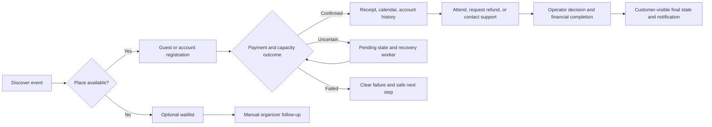

# Flyte site-solution audit

22 October 2026 · Assessed implementation: `8ea1d34` on `stabilization/ui-elaboration`

## Assessment

**Flyte is a capable single-operator event registration and payments site. Its commerce core is more complete than its surrounding customer-service and operational workflows.** The most valuable remaining work is to close those workflows, make public promises match actual behavior, and establish reliable operating procedures. More product breadth or a new architecture is not the immediate need.

The implementation supports discovery, guest-first free/paid registration, account history, capacity control, refunds, event cancellation, waitlists, administration, and analytics. Prior testing demonstrated payment and capacity consistency through contention, uncertain processor responses, and constrained infrastructure. This audit does not reopen those passing results or imply that all unimplemented ideas are defects.

Two additional source-confirmed customer-path defects deserve early attention: a refunded/cancelled guest booking is described as an uncaptured payment, and expired email verification directs customers into a signup loop. Operational readiness is less established than transaction correctness: reliable inbox delivery, exceptional-case ownership, post-sale communication, and recurring restore evidence require explicit completion or verification before unattended public sales.

## Scope and inferred product goals

The repository contains three historical layers: an authentication foundation, a capacity-limited registration engine originally described for mahjong tournaments, and a broader community-event storefront. The current implementation is the event domain built on that foundation. The older specs are useful evidence of intent, but their historical “out of scope” lists do not override functionality subsequently implemented. [E01], [E02], [E03]

The goals embodied by the current site appear to be:

1. Let one organizer sell or allocate limited places without forcing an account on every attendee.
2. Keep money, seat availability, and customer-visible registration state consistent.
3. Let customers recover bookings, build an optional account history, and ask for refunds.
4. Give the operator practical event, customer-service, financial, and sales oversight.
5. Handle short, potentially sharp registration bursts with a small deployment and understandable operations.

These are inferred from the site and design decisions, not a new product mandate. The audit does **not** assume a multi-organizer marketplace, tournament scoring system, CRM, or general-purpose ticketing enterprise. One registration per participant, USD pricing, manual waitlist handling, and operator-reviewed refunds are reasonable v1 boundaries when clearly communicated. Day-of check-in and the live drop console were explicitly deferred. [E02], [E03], [E04]

This assessment examined route wiring, controllers/services, customer/admin templates, design documents, runbooks, and the existing review/load evidence. It introduces no new live transactions or deployment changes. Newly identified defects are source-confirmed unless otherwise stated; no fresh browser reproduction or inbox/restore drill was performed for this audit. Public policy findings concern product accuracy and workflow alignment, not a determination of legal compliance.

## Structure and functional footprint

| Surface | What exists | Fit and boundary |
|---|---|---|
| Public storefront | Home, searchable/month-filtered upcoming and past catalogs, pagination, event detail, images/fallbacks, date/time/location, maps, availability, pricing, sold-out/waitlist choices | Good small-catalog discovery and purchase entry point. No need for a recommendation engine or larger content platform. |
| Registration | Guest/account checkout, repeated email entry for guests, optional phone, free registration, Stripe Payment Element for paid places, capacity enforcement, confirmation/pending/failure routes, calendar download | Core transaction path is implemented and tested. Same-page Back/Continue works; fresh-page paid-attempt resumption remains incomplete. |
| Identity and customer account | Signup/verification, login/reset, profile/password, guest-created shadow accounts, activation, dashboard, registration/waitlist history | Account activation adds convenience without displacing guest access. Expired verification guidance and some guest/account parity need attention. |
| Guest self-service | Capability confirmation links, emailed booking-link recovery, refund request, waitlist position link | Appropriate for guest-first commerce. A bearer link is intentionally sufficient access; email-only disclosure of payment secrets would not be an acceptable “fix.” |
| Event operations | Draft/create/edit/open/close, capacity/price controls, image management, roster/waitlist views and CSV, cancellation/refunds | Enough for a single organizer to run registration. Post-sale updates and manual waitlist fulfillment lack a complete recorded workflow. |
| Financial support | Transactions/filter/export, detail and processor references, full/partial refunds, request approval/denial, durable refund operations, cancellation recovery | Strong registration-level accounting mechanics. Customer-facing terminal states and exceptional operator handling are less complete. Processor payouts, bank settlement, and bookkeeping remain external operator responsibilities. |
| Administration | User lookup/history, suspension/unlock, activity, needs-attention panel, recovery freshness, pending refund-operation links | Useful back office already exists. There is no need to invent another dashboard before improving ownership, actionable detail, and follow-through. |
| Analytics | Revenue/customer summaries, event performance, booking curves/projections, page-view data, accessible chart tables | Useful descriptive reporting; incomplete historical page-view coverage and a small dataset limit interpretation of conversion and forecasts. |
| Supporting operations | Health/readiness, scheduled recovery, explicit deployment, migrations, logs, SMTP integration, static contact/terms/privacy | Mechanisms are present. Evidence for recurring operational practices and actual delivery is incomplete. |

The source route map is [E05]. Detailed operational state and previous verification are in [the consolidated handoff](REVIEW-AND-RESILIENCE-SUMMARY.md) and [stabilization runbook](STABILIZATION.md).

## Explicit and implied workflows

| Journey | Current completion | Missing closure or explicit operating decision |
|---|---|---|
| Discover → choose → register | Present, with free and paid paths | Explain that beginning payment does not guarantee a seat; preserve a safe recovery path when a page closes or a response is lost. |
| Guest purchase → recover link → activate account | Present | Improve verification-error guidance and preserve guest/account parity for refund/cancellation status. |
| Processor uncertainty → reserve state → retry → final outcome | Mechanically demonstrated | Give the customer a credible waiting experience and the operator an owned exception procedure; deep backlog behavior remains unmeasured. |
| Refund requested → reviewed → money returned → customer informed | Present in core and admin UI | Align deadline/approval promises; show guest progress and final amounts; handle notification failure explicitly. |
| Sold out → waitlist → place reopens → person books | Enrollment and position exist; fulfillment is manual | Resolve conflicting copy, assign the contact step, and record whether an entry was contacted, declined, or fulfilled when volume warrants it. A waitlist position is not a reserved offer. |
| Sell places → change time/location → attendees adjust | Event editing exists | Attendee notification is not wired to edits. A documented manual communication step is an acceptable initial completion. |
| Cancel event → halt sales → settle/refund → explain cancellation | Financial freeze/recovery exists | Guests need a truthful final receipt/status; attendees and waitlisted people need a clear cancellation message. Public cancelled-event links currently disappear from the catalog/detail read model. |
| Close registration → export roster → admit attendees | Roster/CSV supports manual day-of handling | Identify the actual admission procedure. Built-in check-in is optional unless the organizer commits to using it. |
| Launch → observe → intervene → recover/restore | Several mechanisms exist | Assign ownership, prove delivery and restoration, and distinguish the testbed from a real sales release. |

## How priorities are used

- **Must have:** fix a broken supported journey, make a material public promise truthful, or complete/verify an operating prerequisite before depending on it for real public sales. Some can be satisfied by a named manual process, not more software.
- **Improvements:** materially reduce friction, support work, or measured operational risk in the existing product.
- **Polish:** improve clarity, consistency, and ease without changing the business capability.
- **Nice to have:** useful only when an identifiable workload or customer need warrants it.
- **Interesting but possibly low value/irrelevant:** defer unless product scope changes or evidence establishes value.

“Must have before public sales” does not mean the current testbed must stop operating. Unknown operational arrangements are marked **verification gaps**, not presumed absent.

## Must have

| ID | Gap and evidence | Smallest acceptable completion |
|---|---|---|
| **M1 — Truthful guest terminal states** | `showConfirmed` handles pending and confirmed separately, but all other statuses—including refunded `CANCELLED`—receive “Your payment was not captured.” A previously captured/refunded customer therefore gets incorrect financial history. The guest receipt also lacks account-style refund progress. **Source-confirmed defect.** [E06], [E07] | Render distinct failed, expired, cancelled/refunded, and confirmed states. Show captured/refunded/remaining amounts and the appropriate next step. Verify full and partial refunds, event cancellation, free cancellation, and a genuinely never-captured attempt. Do not encourage repurchase after cancellation. |
| **M2 — A usable expired-verification path** | The failed-verification page links to signup; signup rejects an email already registered. The normal reset flow issues tokens only for verified or shadow accounts, so an ordinary unverified signup cannot recover through it either. **Source-confirmed self-service dead end; support/manual intervention is needed today.** [E08] | Offer a safe resend-verification flow, or deliberately extend and test an email-ownership recovery flow for unverified signups. Exercise expired, already-used, and failed-delivery cases; preserve neutral responses and administrative-suspension protection. |
| **M3 — Public promises and service ownership agree** | Terms say refundable until the event; request eligibility checks confirmed state without a date cutoff, while admins may approve/deny. Event detail and the waitlist form promise an availability email, but acknowledgment/position/admin copy says manual handling and no system alerts. Contact uses `SMTP_FROM`; privacy prose omits optional phone and operational/audit data. These are product-policy inconsistencies, not proof of legal noncompliance. [E09], [E10], [E11] | Decide and publish the refund request deadline, approval/exception policy, and expected response time; use request time correctly for pre-deadline submissions. Make every waitlist surface promise the same manual service. Configure and verify a monitored support address independent of sender identity. Describe actual data use and who handles correction/deletion requests. Manual fulfillment is acceptable if owned. |
| **M4 — Reliable transactional communication** | Confirmation retries and logged send failures exist, but real inbox delivery was not established. Refund notifications claim delivery work before sending and remain best effort; some request/decision messages lack durable retry. A successful SMTP call also does not demonstrate delivery to the inbox. **Implementation limit plus verification gap.** [E12], [E13], [E14] | Verify confirmations, activation/reset, recovery links, and refund decisions with a real recipient mailbox. Provide an operator-visible failure/resend procedure with an identified owner. Financial state must remain authoritative when mail fails; do not resend money to resend a receipt. A full messaging platform is unnecessary. |
| **M5 — Post-sale changes reach attendees** | Date/location edits have no attendee-notification action; automated event-update mail is explicitly deferred in the design. This becomes a must-have process whenever such changes are allowed after bookings. Cancellation financially settles records but does not supply a complete event-change communication workflow. [E15], [E03] | Require an operator to review affected confirmed attendees and notify them of material changes or cancellation, recording completion. An exported roster plus an approved message is a valid first version. Update the site details and explain refund/support options; automatic sending can follow later. |
| **M6 — Owned exceptional-payment handling** | Dashboard recovery freshness and pending-refund links already exist. Unknown refund operations stop automatic retry after 23 hours. The remaining gap is an executable, owned escalation/resolution procedure, not an absent dashboard. [E13], [E16] | Define who checks stale recovery and unresolved operations, when to escalate, how to investigate processor IDs/amounts, and how to record resolution safely. Include a check before and during a sales burst. Verify that an old unresolved item is noticed without relying on an agent reading logs. Never blindly create another refund. |
| **M7 — Proven ongoing recovery and release readiness** | Campaign snapshots and a coordinated rollback runbook are evidenced; a recurring backup policy, retained compatible images, and a completed restore drill are not. The deployment remains a testbed with earlier real Stripe test-mode smoke checks. **Verification gap, not a claim that the owner has no backups.** [E14], [E17] | Record backup cadence/retention, acceptable data-loss and restore-time targets, owner, and a successful isolated restore drill. Before real sales, verify actual domain, payment mode/webhook subscriptions, supported browser payment completion, monitored mail, admin credentials, and removal of demo exposure. Preserve the single-owner/manual deployment policy and compatible DB/application rollback. |

## Improvements

| ID | Focused improvement | Completion criterion / boundary |
|---|---|---|
| **I1 — Checkout interruption and pending-state recovery** | Existing same-page Back/Continue is useful, but refresh/new-page resumption is deferred. Pending users may wait minutes and must manually check. [E06], [E14] | Safely recover an owned existing attempt without revealing secrets by email alone; explain pending state, discourage duplicate purchases, and add bounded, progressively slower status checks. Test refresh, closed tab, delayed response, and eventual completion. |
| **I2 — Complete manual waitlist lifecycle** | Guests can view position but cannot leave from the capability page; signed-in users can remove their own entry. Operators can view/export entries but have no contact/offer/decline/fulfilled state. [E10], [E18] | Add a scoped guest withdrawal action and, if needed, minimal operator notes/status. Remove stale entries after fulfillment. Define how an invitation relates to publicly available capacity; do not imply a reserved place or strict priority unless enforced. Automation remains optional. |
| **I3 — Consistent customer service across guest/account views** | Account detail has refund-request status; guest routes provide less history. There is no complete attendee-correction or email-loss workflow in the exposed back office. [E07], [E19], [E05] | Show refund decisions and history on the existing authorized guest link. Establish a verified support procedure for mistaken names/contact data; audit any correction and avoid automatic ownership reassignment based only on a claimed email. Start with support tooling, not ticket transfers. |
| **I4 — Event lifecycle presentation** | Cancelled events are hidden from public detail, while waitlist views can still combine terminal status with “still full” copy. Free-registration cancellation uses refund terminology. [E20], [E18], [E07] | Use a safe public cancellation notice for known public events, coherent closed/cancelled waitlist states, and “Cancel registration” wording for zero-price bookings. Keep financial history available to its holder. |
| **I5 — Shared-network burst handling** | The existing per-IP/per-event limiter rejected 140/200 test attempts, and replies have no `Retry-After`. Shared venue WiFi can make legitimate buyers look like one source; counters are per web process. [E21], [E17] | Rehearse representative shared-IP bursts, choose a documented policy, and return helpful retry timing. Preserve abuse protection and measure rejection rates. Do not mistake this for global capacity admission control. |
| **I6 — Bounded expensive reporting** | One of 50 ten-year analytics requests returned HTTP 502; cause was not isolated. Ordinary reports also slowed under pressure. [E17] | Reproduce with request correlation/server timings, then address the measured cause. Consider bounded report concurrency or a short cache if justified. Demonstrate acceptable reporting and checkout together; do not label every network delay a server defect. |
| **I7 — Backlog fairness and recovery visibility** | Capture recovery is serial. Refund recovery selects the oldest 100 pending items; sufficiently many permanently unresolved old items could crowd out later ones. This is a source-supported risk, not a demonstrated production outage. [E13], [E22] | Exercise a large backlog under continuing faults. Record oldest age, drain rate, and progress of later items. Establish explicit exception handling/fairness before increasing concurrency; avoid long-held row locks becoming customer retry delays. |
| **I8 — Durable operational audit detail** | Several administrator actions use best-effort activity logging; cancellation does not record an explicit acting-admin event in its controller, and the direct-refund activity metadata omits some operation context. Financial ledgers remain separate and durable. [E15], [E23] | Join actor, reason, event/registration, operation ID, and before/after values for material changes. Surface audit-write failures. This is more valuable than more dashboard charts when investigating a customer dispute. |
| **I9 — Sustainable maintenance and documentation** | README/spec/history span an auth starter and an event product; older documents claim authority or suggest deployment/rollback practices superseded by stabilization. Browser completion checks remain manual. [E01], [E14] | Mark historical specs explicitly and give one current product/operations entry point. Add a small browser regression set for guest/free/paid flow, pending/refunded states, uploads, and mobile navigation when practical. Rehearse payment-method features actually offered. |

## Polish

| ID | Bounded refinement | Why it belongs here |
|---|---|---|
| **P1** | Use consistent “registration,” “booking,” “cancel,” and “refund” language; distinguish initial amount from refunded balance. | Makes existing state easier to understand after the correctness fixes in M1. |
| **P2** | Improve receipt usefulness: include event date/time/location directly in transactional email and make registration references easy to copy. | Confirmation mail currently emphasizes event name, amount, and link. No new business capability is needed. [E12] |
| **P3** | Review empty, expired, denied, closed, and cancelled screens as a single set, including return destinations and support links. | Terminal-state wording is more valuable than cosmetic redesign; M1/M2 are the blocking subset. |
| **P4** | Finish keyboard/focus/error-announcement checks and consistent mobile interaction testing. | Prior responsive and chart-accessibility repairs are real; comprehensive assistive-technology coverage is still unverified. Raise any discovered access-blocking defect to must-have rather than leaving it “polish.” [E14] |
| **P5** | Reduce excessive no-image card height where useful and clarify analytics sample coverage/forecast uncertainty. | Preserve the approved visual identity; improve density and interpretation without inventing precision. |

## Nice to have — build only against a concrete need

| ID | Capability | Trigger that would justify it |
|---|---|---|
| **N1** | Event duplication/templates and scheduled opening/closing | Repeated events make manual recreation or timed sales opening error-prone. Keep publication controls explicit. |
| **N2** | Event reminder messages and richer schedule/duration fields | No-shows, schedule questions, or multi-session events justify maintained reminder/temporal data. Avoid a general campaign system. |
| **N3** | Minimal day-of check-in with roster lookup, then QR scanning | The operator actually needs recorded attendance or faster admission than the existing CSV/manual process. Check-in was intentionally deferred. [E03] |
| **N4** | Time-limited waitlist offers | Manual fulfillment becomes unreliable. Define seat reservation, expiry, decline, and fairness first; position alone is not an offer mechanism. |
| **N5** | Narrow live drop view and operational counters | A real mass-mail sale makes minute-level bookings, errors, pending age, and rate-limit rejections actionable. Start with these questions, not the entire pinned telemetry design. [E04] |
| **N6** | Additional registration fields, group purchases, discounts, or ticket classes | A specific tournament/class demands participant attributes, family/group purchases, or price variants. Each expands capacity/refund rules; do not assume demand from the existing generic “attributes” concept. |

## Interesting but possibly low value or irrelevant now

| Candidate | Assessment |
|---|---|
| Multi-organizer marketplace, payouts, elaborate permissions | A different product and trust model. The current admin role is a single-operator back office; do not imply tenant isolation that is not implemented. |
| Tournament scoring, pairings, rankings, or social/community features | The original mahjong context does not establish that registration software must run the tournament itself. Integrate with a real need before expanding scope. |
| AI recommendations, elaborate forecasting, attribution suites | Sparse event histories and incomplete view coverage make these easy to overbuild and hard to trust. Descriptive measures and clear definitions have higher present value. |
| Microservices, SPA rewrite, multi-region redesign, distributed queues everywhere | No demonstrated need from these tests. Broader architecture work is expressly deferred; performance CPUs are the owner's preferred simple future capacity adjustment and have not been applied. |
| Full marketing automation/Postmark engagement overlay | A mailing tool can remain external. Integrate only when a specific operational decision depends on those data; the existing drop-console document is a pin, not a commitment. |

These are not permanent rejections. A new business requirement can change their priority; technical interest alone should not.

## Recommended order of work

1. **Close factual customer-path defects:** M1 and M2, then the promise inconsistencies in M3. These are bounded changes with clear acceptance cases.
2. **Complete a real-event operating rehearsal:** prove mail/support routing, enact the post-sale change procedure, review recovery exceptions, and restore a backup. Close M4–M7 with evidence and named responsibility, not additional UI by default.
3. **Reduce recurring customer friction:** interrupted checkout, pending-state guidance, guest waitlist withdrawal, and guest/account status parity (I1–I4).
4. **Address measured operating risks:** shared-IP throttling, the analytics 502, recovery backlog fairness, and audit detail (I5–I8). Keep infrastructure experiments separate from application correctness.
5. **Select optional features from actual event experience:** favor repeated support/operating pain over completing every item in a historical design document.

No new feature implementation, CPU change, or deployment is authorized by this audit document itself. The result is a prioritized product/operations assessment, not a commitment to implement the entire list.

## Evidence index

The citations below refer to files inspected at the assessed revision. Existing test evidence is distinguished from source analysis throughout the findings.

[E01]: SPECIFICATION.md
[E02]: design/ELABORATION-KICKOFF.md
[E03]: design/SITE-MAP-AND-STORYBOARD.md
[E04]: design/DROP-DAY-LIVE-OPS.md
[E05]: src/web/app.ts
[E06]: src/web/controllers/registration.ts
[E07]: src/web/views/registration-confirmed.ejs
[E08]: src/web/controllers/auth.ts
[E09]: src/web/controllers/refund-request.ts
[E10]: src/web/views/event-detail.ejs
[E11]: src/web/controllers/static-pages.ts
[E12]: src/registration/services/NotificationService.ts
[E13]: src/registration/services/RefundService.ts
[E14]: STABILIZATION.md
[E15]: src/web/controllers/admin/events.ts
[E16]: src/web/controllers/admin.ts
[E17]: load_testing/FLY_STRESS_RESULTS_2026-10-22.md
[E18]: src/web/views/waitlist-position.ejs
[E19]: src/services/account-service.ts
[E20]: src/services/catalog-service.ts
[E21]: src/web/middleware/rate-limit.ts
[E22]: src/registration/services/ReconciliationService.ts
[E23]: src/web/controllers/admin/registrations.ts

Key cross-checks for the highest-priority findings:

- M1: [confirmation controller](src/web/controllers/registration.ts#L194), [guest receipt](src/web/views/registration-confirmed.ejs), [account refund presentation](src/web/views/account-registration-detail.ejs).
- M2: [verification-error link](src/web/views/verify-email-error.ejs#L5), [existing-email signup handling](src/web/controllers/auth.ts#L104), [reset-token issuance restriction](src/web/controllers/auth.ts#L182), [reset completion behavior](src/services/user-service.ts#L124).
- M3: [terms](src/web/views/static/terms.ejs), [privacy](src/web/views/static/privacy.ejs), [optional phone field](src/web/views/registration-form.ejs#L56), [waitlist form promise](src/web/views/waitlist-form.ejs#L48), [waitlist email](src/registration/services/NotificationService.ts#L77), [manual admin instructions](src/web/views/admin/event-detail.ejs), [refund eligibility](src/services/account-service.ts#L31).
- M6: [existing recovery and pending-refund panel](src/web/views/admin/dashboard.ejs), [23-hour refund boundary](src/registration/services/RefundService.ts#L71).
- I2: [account-only withdrawal](src/web/controllers/account.ts#L33); I7: [oldest-100 pending refund selection](src/registration/services/RefundService.ts#L106).
